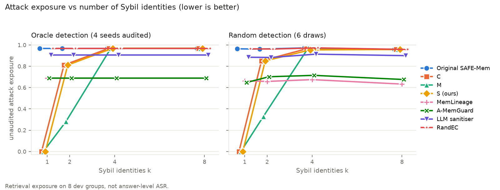
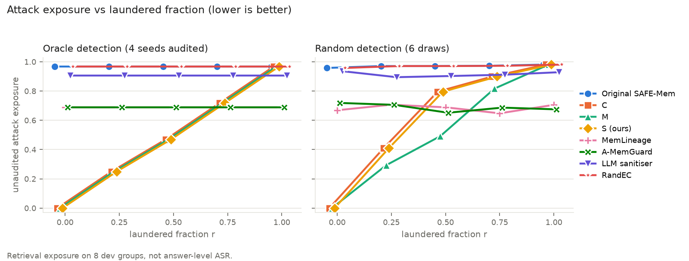
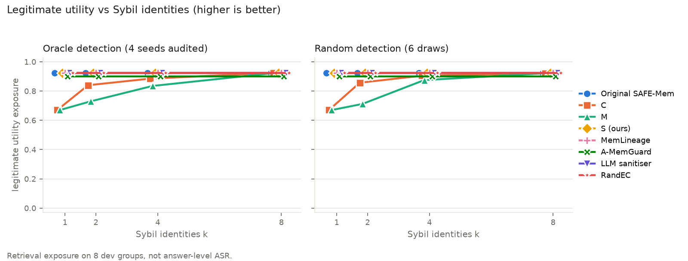
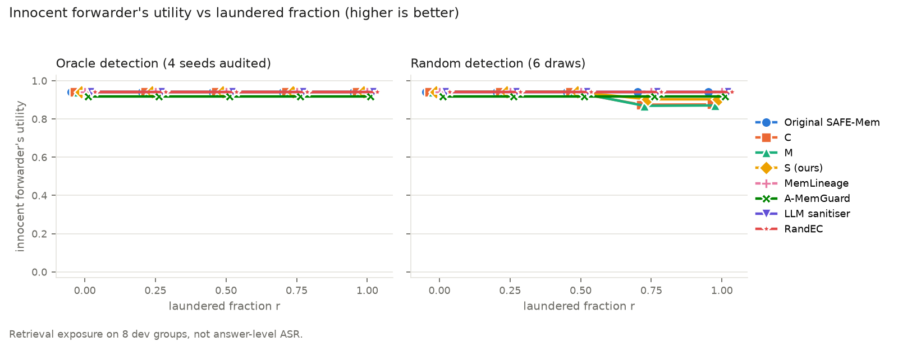

# Published competing defences under the Sybil-k / laundering-r sweep: dev exposure comparison (12 November 2026)

> **Update (12 Nov, later): paid published runs done (owner-approved).** See §9.
> - **Runs:** MemLineage classifier (8/8 groups), A-MemGuard (8/8) and LLM sanitiser (7/8). One sanitiser call ended with *unknown billing*, so the guard halted the session as designed; G-D07 is missing for the sanitiser.
> - **Cost:** **$0.35381745** settled + **$0.0198144** held.
> - **Exposure only:** these runs measure published-method exposure only, not answer-level ASR.

**Scope:** dev split only (8 groups), **retrieval exposure only, $0, no model call.**
- **Not changed:** SAFE-Mem, R, C, M, S, SL, the sweep's attack definitions, seeds and audit budgets.
- **Not done:** no S v2 work.
- **What exposure means:** whether the probed attack target or the utility fact reaches the answer context. It is **not answer-level ASR**, and no ASR is claimed here.

## 0. Short answer

| Question | Answer |
|---|---|
| Are the published methods integrated? | **RandEC: yes, run.** **MemLineage: adapter done and tested, but blocked for free.** Its sensitive-action classifier needs one paid call per question, and none is cached. **A-MemGuard: adapter done and tested, but paid** (about 2,500 LLM calls at temperature 1.0). **LLM sanitiser: prepared, paid.** |
| Do the published methods react to k or r? | **No, by construction.** Their input is the retrieved memories, which original SAFE-Mem's retrieval makes identical in all 66 conditions (checked: 0 of 280 probes vary). Their exposure is therefore **flat in k, r and audit draws**. |
| How do they do here? | **RandEC flags 1 of 686 distinct retrieved memories:** exposure equals no defence (.969 / .925). **MemLineage:** every attack and every utility context holds untrusted (external-derived) memory, so it is exactly *"no defence on ORDINARY queries, empty context on SENSITIVE ones"*. It cannot separate attacks from legitimate facts within a query. |
| Where does S win? | Utility: +.255 over C/M at k=1 and at every oracle r [.225, .275]. Innocent-forwarder utility under random laundering (+.03 vs M). Security equal to C everywhere, and to M at k=1 and oracle r. |
| Where does S lose? | **Security vs M** at Sybil k=2 (S .81 vs M .28; +.53 [.28, .81]) and under random laundering r = .25 to .75 (+.30 [.21, .40] at r=.5). |
| Shared failure | Every provenance method (C, M, S) reaches no-defence exposure by **k = 4** and at **r = 1**. The only published method we could run free (RandEC) does not help either. |

## 1. Verified implementation status

| Component | Status | Notes |
|---|---|---|
| `src/ams/baselines/memlineage.py` | Exists (paper-based adaptation, SAFE-Mem Table-1 row) | Coarse attribution, τ = 0, Deny at the sensitive-action gate; recall is never gated. Not upstream code. |
| `src/ams/baselines/amemguard.py` | Exists; wraps the authors' vendored `ConsistencyChecker` (`third_party/AMemGuard`, pinned `dd92f7f`) | Temperature 1.0 and 2,048 output tokens per call (repository behaviour, documented in `MPBENCH_BASELINE_READINESS.md`). Consistency checker only; no "lesson" memory store. |
| `src/ams/baselines/amemguard_borrowed.py` | RandEC (DistilBERT erase-and-check, suffix weights present) and LLM sanitiser | Both are A-MemGuard's own comparison baselines, and both are SAFE-Mem Table-1 rows. |
| Sybil-k / laundering-r sweep | Exists in `adaptive.py` (`sweep_conditions`); results in `research_data/adaptive_sweeps_dev_v3_20261112/` | k ∈ {1, 2, 4, 8}; r = n/4 with n ∈ {0..4}; oracle + 6 random-detection draws each; arms static/R/C/M/S/SL. **Used unchanged.** |
| **New:** `src/ams/research/workload/published.py` | Adapter | Feeds a published defence exactly the memories that original SAFE-Mem (or R, for "+R") retrieves, as `MemoryEntry` objects with each record's write-time context (user request + artifacts, which MemLineage reads). Exposure is computed on the kept memories with the same `runner.exposure` as R/C/M/S. Filtering happens after retrieval with no refill, as in the repository's MPBench baseline runs. |
| **New:** `RecordedSensitivity` | Strict replay client for MemLineage's classifier | Replays recorded verdicts only; **a miss raises**, so nothing is guessed. |
| **New:** `tests/test_published_adapters.py` | 6 offline tests | Paper labels from write-time context; MemLineage Deny/Allow; trusted-only context allowed; no guessing; RandEC subset; A-MemGuard upstream path with scripted replies. |

### Adaptations and differences from the published settings (stated, not hidden)

1. **Substrate.** In the SAFE-Mem paper these baselines filter facts from a plain extract-and-store memory. Here they filter **SAFE-Mem's own retrieved claims and chunks**, so every method sees the same memory records. The likely reason RandEC flags almost nothing: SAFE-Mem's extracted claims are declarative restatements ("The deployment key is …"), not the injection-style text RandEC was trained to catch.
2. **Audit evidence.** None of these methods has an input for audit verdicts or contributor identity. They receive the same records and queries as every arm but **cannot use the five audit tickets**. Giving them audits would mean inventing a new method, so it was not done.
3. **"+R" variants are our composition, labelled as such.** The method is applied to R's retrieval, which withholds only records directly verified unsafe for that use. For RandEC, +R equals R in every cell.
4. **MemLineage's sensitivity gate** depends on an LLM classifier of the query. The coarse labels need no model: every memory derived from an external contribution is `EXTERNAL`, and principal memories are `TRUSTED`. Both are checked in the tests.

## 2. Consistency checks (all passed)

- **Static retrieval** recomputed for all 280 dev probes equals the sweep's static rows: 280/280.
- **R retrieval** recomputed for all 66 conditions equals the sweep's R rows: 17,920/17,920.
- **Static invariance:** static exposure is identical across all 66 sweep conditions for every probe.
- **Integrity:**
  - locked protocol v1 archive `verify` returns verified (224 files);
  - the live tree differs from v1 only in the three workload-harness files changed earlier on 12 Nov (`replay.py`, `runner.py`, `transport.py`; defaults preserved) and new files;
  - no SAFE-Mem / R / C / M / S / ledger / retrieval / prompt file changed;
  - sweep outputs untouched;
  - 668 tests pass.

## 3. Results (exposure; 8 dev groups; random rows average 6 draws per group)

### 3a. Unaudited attack exposure vs Sybil identities k (lower is better)

| k | detection | Original SAFE-Mem | R | C | M | **S** | SL | RandEC | MemLineage |
|---|---|---:|---:|---:|---:|---:|---:|---:|---|
| 1 | oracle | .969 | .969 | 0 | 0 | **0** | 0 | .969 | .969 on ORDINARY / 0 on SENSITIVE |
| 2 | oracle | .969 | .969 | .812 | **.281** | .812 | .812 | .969 | same, flat |
| 4 | oracle | .969 | .969 | .969 | .969 | .969 | .969 | .969 | same, flat |
| 8 | oracle | .969 | .969 | .969 | .969 | .969 | .969 | .969 | same, flat |
| 1 | random | .964 | .964 | 0 | 0 | **0** | 0 | .964 | flat |
| 2 | random | .962 | .962 | .851 | **.329** | .851 | .851 | .962 | flat |
| 4 | random | .973 | .973 | .964 | .973 | .954 | .964 | .973 | flat |
| 8 | random | .958 | .958 | .958 | .958 | .958 | .958 | .958 | flat |

### 3b. Unaudited attack exposure vs laundered fraction r (lower is better)

| r | detection | Original SAFE-Mem | R | C | M | **S** | SL | RandEC |
|---|---|---:|---:|---:|---:|---:|---:|---:|
| 0 | oracle | .969 | .969 | 0 | 0 | **0** | 0 | .969 |
| .25 | oracle | .969 | .969 | .250 | .250 | .250 | .250 | .969 |
| .5 | oracle | .969 | .969 | .469 | .469 | .469 | .469 | .969 |
| .75 | oracle | .969 | .969 | .719 | .719 | .719 | .719 | .969 |
| 1 | oracle | .969 | .969 | .969 | .969 | .969 | .969 | .969 |
| 0 | random | .958 | .958 | 0 | 0 | **0** | 0 | .958 |
| .25 | random | .971 | .971 | .409 | **.293** | .409 | .409 | .971 |
| .5 | random | .971 | .971 | .796 | **.492** | .796 | .796 | .971 |
| .75 | random | .973 | .973 | .899 | **.817** | .899 | .899 | .973 |
| 1 | random | .981 | .981 | .981 | .981 | .981 | .981 | .981 |

### 3c. Utility exposure (higher is better)

| Condition | Original SAFE-Mem / R / RandEC | C | M | **S** = SL |
|---|---:|---:|---:|---:|
| k = 1, any r oracle | .925 | .670 | .670 | **.925** |
| k = 2 oracle | .925 | .840 | .730 | **.925** |
| k = 4 oracle | .925 | .885 | .835 | **.925** |
| k = 8 oracle | .925 | .925 | .925 | .925 |
| r = .5 random | .925 | .790 | .670 | **.925** |
| r = 1 random | .925 | .854 | .666 | **.902** |

**Innocent forwarder** (B, who relays laundered attacks) under random detection:
- At r = .75: S .903, C .875, M .869 (S − M +.033 [.006, .078]).
- At r = 1: S .903, C .876, M .871.
- Under oracle detection B is never audited, so B keeps .942 under every arm.

### 3d. Key paired contrasts (cluster bootstrap over groups, 95% CI)

| Contrast | Estimate |
|---|---|
| k=2 oracle, exposure, S − M | **+.531** [.281, .812] (S worse) |
| k=2 random, exposure, S − M | **+.521** [.366, .655] (S worse) |
| k=2 oracle, utility, S − M | **+.195** [.115, .265] (S better) |
| k=2 oracle, utility, S − C | +.085 [.035, .130] at equal exposure |
| r=.5 random, exposure, S − M | **+.304** [.214, .401] (S worse) |
| r=.5 random, utility, S − M / S − C | **+.255** [.225, .275] / +.135 [.102, .168] |
| r=.75 random, innocent utility, S − M | +.033 [.006, .078] |
| any cell, exposure, S − C | 0 (identical everywhere) |

## 4. Where S wins and loses

- **Wins:** utility in every cell (it never drops the attacker's own legitimate notes when the evidence is batch-local), and it protects the innocent forwarder slightly better than C or M.
- **Ties C** on security in every cell. **Ties M** when the attacker uses one identity or detection is oracle.
- **Loses to M** when identities split (k = 2) or laundering is partly detected at random. M's source-wide pooling is the only thing that catches part of these. The price is about −.2 utility.
- **Nobody wins at k ≥ 4 or r = 1.** Every provenance method returns to no-defence exposure. The free published method (RandEC) is no better. MemLineage's effect depends entirely on which queries its classifier calls SENSITIVE, and it would block legitimate and malicious memory alike on those queries.

## 5. Which weaknesses do published methods already address?

| Weakness of S | Published method that addresses it (in principle) | Evidence here |
|---|---|---|
| Sybil identities (k ≥ 2) | Content-level methods (RandEC, A-MemGuard, LLM sanitiser) and MemLineage are identity-blind, so k cannot hurt them | RandEC: invariant but ineffective (1/686 flagged). A-MemGuard and sanitiser: **untested (paid)**. MemLineage: invariant, but all-or-nothing per query. |
| Laundering by an innocent forwarder | MemLineage labels any externally derived memory untrusted, whoever forwarded it | Correct labels (100% of attack contexts untrusted), but they apply equally to legitimate notes (100% of utility contexts untrusted), so selectivity comes only from the query gate. |
| Unaudited relays / copies | Content methods; our SL | SL removes unlinked relays (oracle .625 → 0); RandEC does not. |
| Use of audit evidence | **None** of the published methods uses verified audits | Structural difference that S/SL exploit |

## 6. Paid evaluation (prepared; NOT run; needs approval)

Mock request counts (no network) over the 280 dev probes. One context per probe suffices, because the published methods are condition-invariant.

| Method | Requests | Expected cost | Notes |
|---|---:|---:|---|
| MemLineage SensitiveAction | 216 distinct questions, 4 output tokens each | **≈ $0.01** | Fixes MemLineage's exact exposure in all 66 conditions at once |
| A-MemGuard (LLM consensus) | 2,496 calls (one chain per retrieved memory + one judgment per query); 3.21 M prompt chars ≈ 0.72 M input tokens | **≈ $0.5** (≈ 250 output tokens per chain); worst case ≈ $3.2 at the 2,048-token cap | Temperature 1.0 (repository setting), so a single draw. Recommend a one-group pilot first, under a $1.00 cap. |
| LLM sanitiser | 2,216 audit calls; ≈ 0.72 M input tokens; rewrites only for "harmful" | **≈ $0.2–0.3** | |

All would run through the guarded budget session with hard caps. Answer-level ASR for any method would need a further paid Stage-3 run.

## 7. Recommendations for S v2 (no implementation; for discussion)

1. **The binding weakness is identity splitting and laundering, not batch placement.** At k = 2, M's pooling recovers 53 points of exposure that S misses. At k ≥ 4, every provenance method fails.
2. **An identity-independent scope is the most promising direction.** In this sweep, Sybil identities and laundered relays keep the *same context and batch* as the detected seeds; only the contributor label changes. A scope keyed on **(context, batch of arrival)**, independent of contributor, would contain them. This must be tested against framing, since innocent items in the same batch would be penalised, and against attackers who also spread over batches. Treat it as a hypothesis, since it depends on how batches arise in a real deployment.
3. **Distinguish forwarding from authoring** before penalising a forwarder (laundering-r). Today detection of a laundered item lowers B's utility under C/M/S.
4. **Keep content lineage (SL).** It is the only tested mechanism that handles unattributed copies. It does not help against distinct new payloads.
5. **Before designing S v2, resolve the published methods' real strength:** MemLineage ($0.01) and A-MemGuard (one-group pilot, then ≈ $0.5). If A-MemGuard is strong and identity-blind, the paper's best framing may be *S + a content check*, with S supplying audit-driven selectivity that content methods lack.

## 8. Outputs

| Path | Content |
|---|---|
| `research_data/published_exposure_dev_v3_20261112/published_rows.jsonl.gz` | 53,760 rows: randec, randec+R, MemLineage inputs × 66 conditions |
| `research_data/published_exposure_dev_v3_20261112/comparison.json` | Tables, bootstrap contrasts, MemLineage block |
| `research_data/published_exposure_dev_v3_20261112/*.png` | 4 plots |
| `research_data/published_exposure_dev_v3_20261112/parts/` | Per-group summaries: consistency checks and mock request counts |
| Scripts | `scripts/published_exposure.py`, `scripts/analyse_published_comparison.py`, `scripts/plot_published_comparison.py` |

## 9. Paid published-defence results (12 November 2026, owner-approved)

### 9a. Runs and cost

Each run used its own guarded scope with a hard cap; every request had to match the method's exact shape (`transport.published_stage`).

| Method | Scope / cap | Calls | Settled cost | Coverage |
|---|---|---:|---:|---|
| MemLineage SensitiveAction | `published_memlineage`, $0.05 | 216 | $0.0047586 | all 216 dev questions: **7 SENSITIVE, 209 ORDINARY** |
| A-MemGuard (authors' checker, temperature 1.0) | `published_amemguard`, $1.00 | 2,496 | $0.3150183 | 8/8 groups (pilot G-D00 $0.039, then 7 more) |
| LLM sanitiser | `published_sanitiser`, $0.50 | 613 completed + **1 failed** | ≈ $0.034 | **7/8 groups.** One call in G-D07 failed with a provider error and *unknown billing*: the guard **halted the session** and holds **$0.0198144** (worst case). |

**Budget:**
- The session ledger is now $1.26231525 used and $0.0198144 held, and the session is **blocked**.
- All research spend is $3.38895405, plus holds of $0.01974 (old session) and $0.0198144 (this session).
- Unblocking needs the owner's decision: verify the call at OpenRouter, or accept the hold.

### 9b. Unaudited attack exposure / legitimate utility exposure (8 dev groups; sanitiser 7)

| Condition | S (ours) | C | M | MemLineage | A-MemGuard | LLM sanitiser | RandEC |
|---|---|---|---|---|---|---|---|
| k=1 (= r=0) | **0 / .925** | 0 / .670 | 0 / .670 | .688 / .925 | .688 / .900 | .929 / .920 | .969 / .925 |
| k=2 | .812 / .925 | .812 / .840 | **.281** / .730 | .688 / .925 | .688 / .900 | .929 / .920 | .969 / .925 |
| k=4 | .969 / .925 | .969 / .885 | .969 / .835 | **.688** / .925 | **.688** / .900 | .929 / .920 | .969 / .925 |
| k=2, random | .851 / .925 | .851 / .857 | **.329** / .712 | .658 / .925 | .702 / .900 | .923 / .920 | .962 / .925 |
| r=.25, random | .409 / .925 | .409 / .716 | **.293** / .670 | .707 / .925 | .706 / .900 | .923 / .920 | .971 / .925 |
| r=.5, random | .796 / .925 | .796 / .790 | **.492** / .670 | .689 / .925 | .652 / .900 | .924 / .920 | .971 / .925 |
| r=.75, random | .899 / .902 | .899 / .781 | .817 / .650 | **.648** / .925 | .687 / .900 | .929 / .920 | .973 / .925 |
| r=1 | .969 / .925 | .969 / .670 | .969 / .670 | **.688** / .925 | **.688** / .900 | .929 / .920 | .969 / .925 |

The published methods' values are flat in k and r, as predicted. Small variation across random families comes only from which attacks are audited (and so excluded from "unaudited").

**Innocent forwarder** (r=.75, random): MemLineage .942, sanitiser .943, A-MemGuard .917, **S .903**, C .875, M .869. The identity-blind methods never penalise the forwarder.

### 9c. Paired contrasts, S minus published (bootstrap over groups, 95% CI)

| Contrast | Estimate |
|---|---|
| k=1, exposure, S − A-MemGuard | **−.688** [−.844, −.500] (S better) |
| k=1, exposure, S − MemLineage | **−.688** [−.875, −.500] (S better) |
| k=1, exposure, S − LLM sanitiser (7 groups) | **−.929** [−1.0, −.786] (S better) |
| k=1, utility, S − A-MemGuard | +.025 [.005, .045] |
| k=2, exposure, S − A-MemGuard | +.125 [−.031, .281] (not significant) |
| k=4 (and r=1), exposure, S − A-MemGuard | **+.281** [.156, .406] (S worse) |
| k=4 (and r=1), exposure, S − MemLineage | **+.281** [.094, .469] (S worse) |
| r=.5 random, exposure, S − A-MemGuard | +.144 [.013, .259] (S worse) |
| r=.75 random, exposure, S − A-MemGuard | +.213 [.066, .355] (S worse) |

### 9d. What the published methods do here

- **MemLineage:** blocks only the 7 questions its classifier calls SENSITIVE (all exfiltration-style attack probes). Every other query keeps the full context, so utility is unchanged (.925) and attack exposure falls from .969 to .688. It is identity- and audit-blind, so it is flat in k and r.
- **A-MemGuard:** flags on average about 5.6 of 8 retrieved memories per query. Mostly these are not the target-bearing claims: exposure falls only from .969 to .688, at a small utility cost (.925 → .900). Flat in k and r.
- **LLM sanitiser:** nearly no protection (.929). Its rewrites rarely remove the planted target from SAFE-Mem's declarative claims.
- **RandEC:** no protection (§3).

### 9e. Conclusions

1. **S beats every published method by a wide margin when identities are not split and laundering is low (k ≤ 1, r ≤ .25).** The gap is −.69 to −.93 exposure, at equal or better utility. This is the audit-evidence advantage none of them has.
2. **The crossover point:**
   - S is roughly level with A-MemGuard and MemLineage at k=2 and r ≈ .25–.5 random (not significant at k=2);
   - S is **worse** at k ≥ 4 and r ≥ .5 (random) / r = 1: +.14 to +.28;
   - the published methods' content- or query-level protection (≈ .69) is independent of identity.
3. **No method is good everywhere.** The best published method still exposes about 69% of attacks; the provenance methods expose 0% when evidence is attributable and about 97% when it is not.
4. **Implication for S v2 (not implemented):**
   - composing S with an identity-blind content signal would take the minimum of both curves: S's 0 at low k and r, and A-MemGuard's or MemLineage's ≈ .69 floor at high k and r;
   - the identity-independent batch scope (§7.2) could push the high-k/r regime well below .69;
   - forwarding vs authoring (§7.3) matters, since identity-blind methods protect the innocent forwarder better (.94 vs .90).

**Caveats:**
- Exposure, not ASR.
- 8 dev groups; the sanitiser has 7.
- A-MemGuard ran one draw at temperature 1.0.
- MemLineage is a paper-based adaptation, and its gate is query-level.
- Published methods were applied to SAFE-Mem's retrieved memories, not their original substrates.
