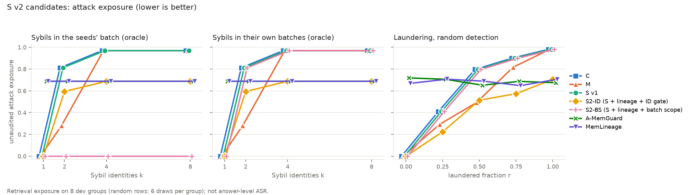
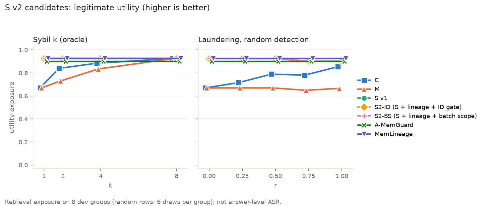
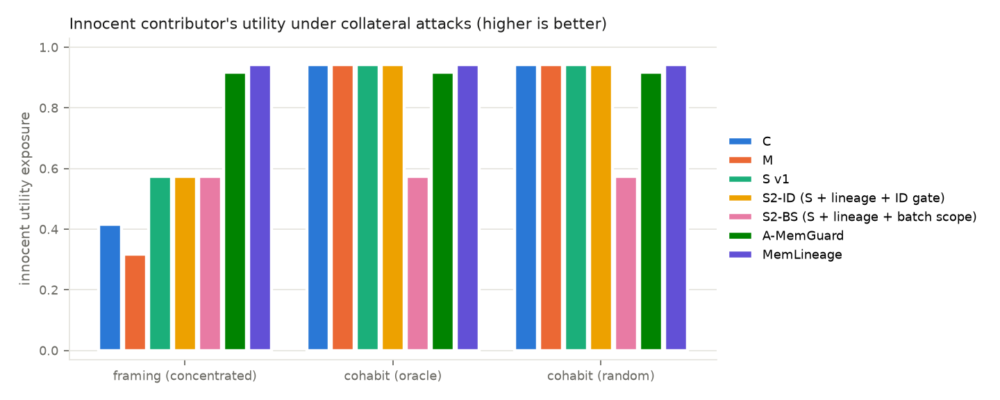

# S v2 candidates: design, implementation and free dev evaluation (12 November 2026)

**Status:** owner-approved design and implementation; **free dev evaluation only**.
- **What exposure means:** whether the probed attack target or utility fact reaches the answer context. It is **not answer-level ASR**.
- **Not done:** no paid experiment, no change to the locked held-out protocol, no protocol-v2 freeze.
- **Original S:** unchanged.

## 1. Why S v2

The free and paid dev comparisons (reports `ADAPTIVE_ATTACKS_DEV_EXPOSURE_20261112`, `PUBLISHED_BASELINES_SWEEP_DEV_EXPOSURE_20261112`) showed:

| Finding | Consequence |
|---|---|
| S = 0 exposure with full utility when attacks are attributable (k = 1, low r) | Keep S's audit-driven, batch-selective core |
| S rises to ≈ .97 (no-defence level) at Sybil k ≥ 4 and laundering r = 1 | It needs a signal that does not depend on the contributor label |
| The published identity-blind methods (A-MemGuard, MemLineage) are flat at ≈ .69 in k and r | Composing S with such a signal should give the better of both curves |
| In the sweep, Sybil identities keep the detected seeds' arrival batch | An identity-independent batch scope might contain them, but only if attackers do not control batches (tested in §4) |
| Content lineage removes unattributed relays; boundary verification shrinks the spread-attacker gap | Both are kept (owner instruction) |

## 2. The candidates (all compositions on top of the frozen `Policy("S")`)

| | S v1 | **S2-ID** | **S2-BS** | S2-ALL (exploratory) |
|---|---|---|---|---|
| Audit-driven scopes (batch / context / source, gates 1 / 2 / 4, threshold 0.25) | ✓ | ✓ | ✓ | ✓ |
| Content lineage (claims with cosine ≥ 0.8 to an unsafe-audited claim are withheld) | – (SL only) | ✓ | ✓ | ✓ |
| **Identity-independent (context, batch) scope**: outcomes of *any* contributor in the same arrival batch; S's batch-gate activation (≥ 1 unsafe) and the same risk / penalty / gate | – | – | ✓ | ✓ |
| **MemLineage sensitive-action gate**: on a SENSITIVE query, a context holding any untrusted (externally derived) memory is emptied | – | ✓ | – | ✓ |
| Boundary-verification auditing (audit protocol, not policy) | evaluated via `_fu` conditions for every arm | same | same | same |

**Exact algorithms (`src/ams/research/workload/sv2.py`):**
- **S2-BS** (`BatchAnyContributorPolicy.decide`):
  1. Take S's decision.
  2. If the record is still eligible, not verified safe for this use, and authenticated-external, collect the verified outcomes of every authenticated root in the same `(context_id, batch_id)`.
  3. If at least one is unsafe, compute S's risk `(1+U)/(2+U+Safe)` and penalty `max(0, risk − 0.5)`.
  4. Take the maximum with S's own penalty. Withhold at ≥ 0.25 (reason `batch_any_contributor_gate`); otherwise rescore with S's weight 0.5.
- **S2-ID** (`_GatedReader`):
  1. Run S + lineage retrieval.
  2. If the query's recorded SensitiveAction verdict is SENSITIVE and any retrieved record is not a principal record, return an empty context (MemLineage's Deny).

  Verdicts come from the paid MemLineage run (`sensitive_action_verdicts.json`, 216 dev questions; 7 SENSITIVE). An unrecorded query raises; nothing is guessed. The MemLineage coarse labels reduce exactly to "external ⇒ untrusted, principal ⇒ trusted" (tested).
- **Lineage:** unchanged `lineage.py` (τ = 0.8), wrapped outermost.
- **Wiring:**
  - `sv2.apply(state, store, candidate)` replaces `state.reader` on one state instance, so the frozen `Policy`, ledger and `GovernedRetrieval` code is untouched;
  - original S is built fresh for its own arm (tested: `test_original_s_untouched_by_candidates`).

**Assumptions stated up front:**
- S2-BS assumes the batch of arrival (delivery window or channel) is assigned by the system, not chosen by the contributor. If an attacker can pick fresh batches for each identity, it evades the scope (stress test `sybilown_k`).
- S2-ID inherits MemLineage's query-level coarseness. On SENSITIVE queries it withholds legitimate external memory too, and it gives no protection on ORDINARY queries.
- On test data it would need new SensitiveAction calls (≈ $0.002 per 100 questions).

## 3. New evaluation conditions (`adaptive.py`, additive; earlier conditions unchanged)

| Condition | What it tests |
|---|---|
| `<sweep>_rand_dN_fu` (54) | Boundary verification on every random-detection draw of the Sybil-k / laundering-r sweep. Same 4 detections; the 5th ticket audits an unaudited item of a flagged contributor in a batch next to the flagged one (`_followup_ticket_any`, the multi-contributor form of the earlier rule). |
| `sybilown_k{2,4,8}` (+ 6 draws, + `_fu`) | **Stress for S2-BS:** the same Sybil deal as `sybil_k`, but every non-original identity's items arrive in a fresh batch of their own |
| `cohabit_x1` (+ 6 draws, + `_fu`) | **Collateral for S2-BS:** the attacker (own identity) delivers all 8 attack items into the innocent B's first batch. Measures B's lost notes. |

## 4. Results (free, dev, 8 groups; random rows average 6–8 draws per group)

**Run:**
- 760,760 exposure rows over 51 condition families.
- Three parts of 8 parallel group processes: (1) the 3 candidates on all 103 existing conditions; (2) 9 arms on 54 sweep `_fu` conditions; (3) 9 arms on 52 stress conditions.
- Published methods are broadcast per probe with each condition's strata.
- No model call.

### 4a. Unaudited attack exposure / legitimate utility exposure

Lower exposure and higher utility are better.

| Condition | C | M | S v1 | **S2-ID** | S2-BS | S2-ALL | A-MemGuard | MemLineage |
|---|---|---|---|---|---|---|---|---|
| localized | 0 / .67 | 0 / .67 | 0 / .93 | **0 / .93** | 0 / .93 | 0 / .93 | .69 / .90 | .69 / .93 |
| distributed | 0 / .67 | 0 / .67 | 0 / .67 | 0 / .67 | 0 / .67 | 0 / .67 | .69 / .90 | .69 / .93 |
| uninformative | .78 / .84 | .56 / .62 | .81 / .83 | **.56 / .83** | .81 / .83 | .56 / .83 | .69 / .90 | .69 / .93 |
| random_spread | 0 / .67 | 0 / .67 | .28 / .70 | .18 / .70 | .28 / .70 | .18 / .70 | .68 / .90 | .69 / .93 |
| random_spread_fu | .08 / .69 | .08 / .68 | .13 / .69 | .09 / .69 | .13 / .69 | .09 / .69 | .68 / .90 | .69 / .93 |
| shift_batch (K3) | 0 / .67 | 0 / .67 | .97 / .78 | .69 / .78 | .97 / .78 | .69 / .78 | .69 / .90 | .69 / .93 |
| shift_context (K3) | .97 / .80 | 0 / .67 | .97 / .93 | .69 / .93 | .97 / .93 | .69 / .93 | .69 / .90 | .69 / .93 |
| Sybil k=2 (seeds' batch) | .81 / .84 | .28 / .73 | .81 / .93 | .59 / .93 | **0 / .93** | 0 / .93 | .69 / .90 | .69 / .93 |
| Sybil k=4 (seeds' batch) | .97 / .89 | .97 / .83 | .97 / .93 | .69 / .93 | **0 / .93** | 0 / .93 | .69 / .90 | .69 / .93 |
| **Sybil k=2, own batches** | .81 / .84 | .28 / .73 | .81 / .93 | .59 / .93 | **.81 / .93** | .59 / .93 | .69 / .90 | .69 / .93 |
| **Sybil k=4, own batches** | .97 / .89 | .97 / .83 | .97 / .93 | .69 / .93 | **.97 / .93** | .69 / .93 | .69 / .90 | .69 / .93 |
| laundering r=.25, random | .41 / .72 | .29 / .67 | .41 / .93 | **.22 / .93** | .41 / .93 | .22 / .93 | .71 / .90 | .71 / .93 |
| laundering r=.5, random | .80 / .79 | .49 / .67 | .80 / .93 | .51 / .93 | .80 / .93 | .51 / .93 | .65 / .90 | .69 / .93 |
| laundering r=.75, random | .90 / .78 | .82 / .65 | .90 / .90 | **.57 / .90** | .90 / .90 | .57 / .90 | .69 / .90 | .65 / .93 |
| laundering r=1 | .97 / .67 | .97 / .67 | .97 / .93 | .69 / .93 | .97 / .93 | .69 / .93 | .69 / .90 | .69 / .93 |
| cohabit (oracle) | 0 / .67 | 0 / .67 | 0 / .93 | 0 / .93 | **0 / .70** | 0 / .70 | .69 / .90 | .69 / .93 |

**Innocent contributor's notes:**

| Condition | S v1, S2-ID, C, M | S2-BS, S2-ALL | A-MemGuard | MemLineage |
|---|---|---|---|---|
| cohabit | .942 | **.575** (S2-BS − S **−.367** [−.467, −.300]) | .917 | .942 |
| framing (concentrated) | S-family .575, C .417, M .317 | – | .917 | .942 |

### 4b. Worst case over all 51 attacker families (unaudited exposure)

| Arm | Worst-case exposure | Where |
|---|---:|---|
| **S2-ID / S2-ALL** | **.706** | laundering r=1, random |
| MemLineage | .718 | cohabit, random |
| A-MemGuard | .764 | Sybil own-batch k=4, random |
| LLM sanitiser | .936 | – |
| S v1, SL, S2-BS, C | .981 | laundering r=1, random |
| M, R, original SAFE-Mem, RandEC | .989 | Sybil own-batch k=4, random |

### 4c. Key paired contrasts (bootstrap over groups, 95% CI)

| Contrast | Estimate |
|---|---|
| S2-ID − S, Sybil k=2 / k=4 | **−.219** [−.375, −.062] / **−.281** [−.469, −.094] |
| S2-ID − S, laundering r=.5 random / r=1 | **−.282** [−.45, −.112] / **−.281** [−.469, −.094] |
| S2-ID − S, random_spread | **−.100** [−.177, −.033] |
| S2-ID − S, utility, every condition | 0 (identical) |
| S2-ID − A-MemGuard, k=1 | **−.688** [−.844, −.500] |
| S2-ID − A-MemGuard, k=4 | 0 [−.25, .25] |
| S2-ID − M, k=2 (same-batch or own batches) | **+.312** [.094, .562] (M better) |
| S2-ID − M, utility k=1 / uninformative | **+.255** [.225, .275] / **+.21** [.09, .33] |
| S2-ID − C, shift_batch | **+.688** [.50, .875] (C better; K3 attacker) |

## 5. Interpretation

1. **S2-BS is rejected.** Its Sybil gain (0 exposure) holds only while Sybil items arrive in the detected seeds' batch. A rule-aware attacker who gives each identity its own batch returns it exactly to S (k=4: .97, Δ = 0). A shared arrival window costs innocent contributors 37 points of their notes. It is kept in the code as a documented negative result.
2. **S2-ID is the recommended candidate.**
   - **Never worse than S** on exposure, with **identical utility** in every condition (all deltas 0).
   - **Meaningfully better under Sybils, laundering and audit-aware shifts:** −.10 to −.28.
   - **The best worst case of all arms** (.706), with original-level utility.
   - Versus the published methods: equal at high k/r, and **−.69** at k=1.
3. **Where S2-ID's gain comes from:** entirely from MemLineage's query-level gate on the 7 dev questions the classifier calls SENSITIVE (exfiltration-style). So:
   - S2-ID ≈ min(S, MemLineage) per query;
   - it does not detect poisoned *memories* on ordinary queries, and its .69 floor is MemLineage's floor;
   - the composition is new; the gate is MemLineage's (paper-based adaptation).
4. **Boundary verification** helps S under the original random spread (.28 → .13) but not under the Sybil or laundering sweeps. It *hurts* C and M there: a safe follow-up finding dilutes their coarse estimates (C .00 → .53 at k=1 random). Recommendation: keep it as an audit-protocol option and report both protocols.
5. **Still unsolved:**
   - partially detected spread attacks (M beats every S variant at k=2: .28 vs .59);
   - laundering at high r and many own-batch Sybils (floor .69 for every method);
   - a real content-level detector that works on SAFE-Mem's declarative claims (A-MemGuard, the sanitiser and RandEC barely do here).

## 6. Limitations

- Exposure, not ASR. Dev only (8 groups, 32 scored attacks). Not pre-registered.
- **Both candidates and both stress conditions were designed after seeing dev results.** A confirmatory claim needs protocol v2 and fresh held-out groups.
- S2-ID needs recorded SensitiveAction verdicts: paid per new question (≈ $0.00002 each).
- Published methods were applied to SAFE-Mem's retrieved memories, not their native substrates. A-MemGuard ran as one draw at temperature 1.0.

## 7. Files and outputs

| Kind | Paths |
|---|---|
| New code | `src/ams/research/workload/sv2.py`; additions in `src/ams/research/workload/adaptive.py` (`sweep_followup_conditions`, `_followup_ticket_any`, `stress_conditions`, `sybilown`, `cohabit`) |
| Evaluator | `scripts/adaptive_exposure.py`: S v2 arms, `--verdicts` |
| Analysis and plots | `scripts/analyse_sv2.py`, `scripts/plot_sv2.py` |
| Tests | `tests/test_sv2_candidates.py` (7) |
| Outputs | `research_data/sv2_exposure_dev_v3_20261112/` (`parts/`, `sv2_analysis.json`, `sv2_analysis_print.txt`, 3 PNGs) |

**Integrity:**
- 675 tests pass.
- The locked protocol v1 archive verifies (224 files).
- The live tree differs from v1 only in the workload-harness files `replay.py`, `runner.py` and `transport.py` (defaults preserved; `transport.py` gained the guarded published scopes), plus new files.
- Sweep and published outputs are unchanged.
- No S, R, C, M, ledger, retrieval or prompt file changed.
